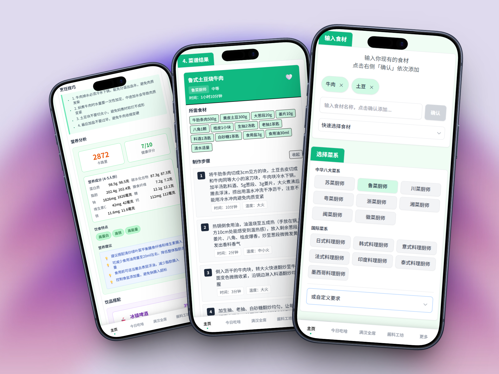
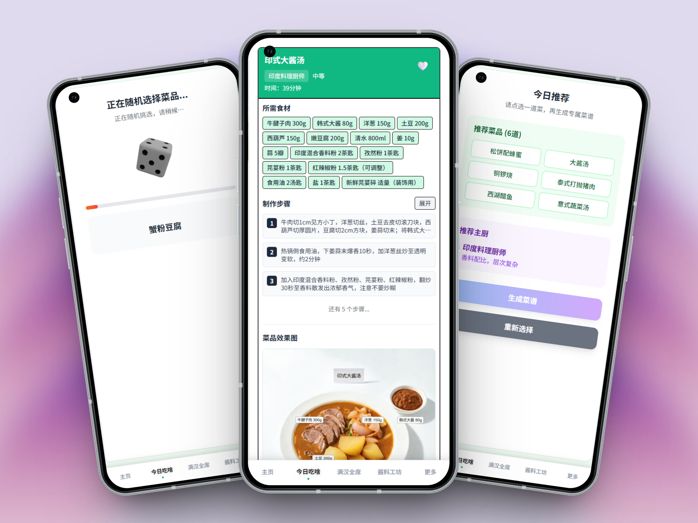
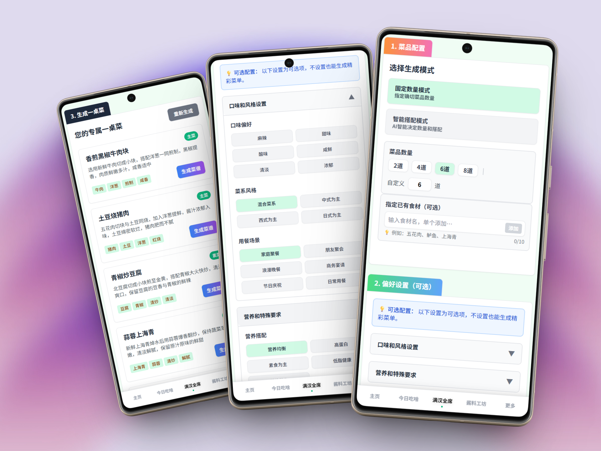
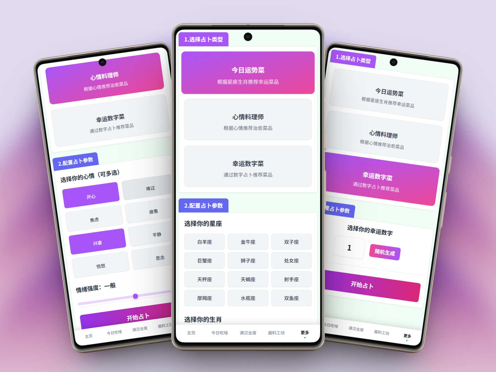

<p align="center">
  
</p>

<h1 align="center">灵机一灶 · ElectronicRecipe</h1>

<p align="center"><strong>把现有食材，变成今天的拿手菜。</strong></p>
<p align="center">食材生成菜谱 · 今日吃啥 · 一桌菜搭配 · 趣味料理灵感</p>
<p align="center">
  <a href="#功能一览">探索功能</a> ·
  <a href="#quick-start">快速开始</a> ·
  <a href="DEPLOY.md">部署指南</a> ·
  <a href="#来源与许可">来源与许可</a>
</p>

冰箱里有牛肉和土豆，却不知道怎么做？每天纠结吃什么，或是聚餐时凑不齐一桌菜单？**灵机一灶**把这些日常难题变成几个简单的选择：输入手边食材、挑选喜欢的菜系，让 AI 帮你整理食材用量、制作步骤与搭配灵感，从一道家常菜到一桌聚餐都有思路。

## 功能一览

### 01 / 食材变菜谱，让冰箱里的食材有着落

**先看看手边有什么，再决定今天做什么。** 添加现有食材，选择中华八大菜系或国际料理风格，也可以填写自定义要求，为同一份食材寻找不同做法。



- **按食材找做法**：手动输入或快捷选择食材，再搭配喜欢的菜系风格。
- **下厨有章法**：生成食材用量、分步做法、时间与火候提示，附上烹饪技巧。
- **搭配多一点参考**：查看营养分析、饮食特点和饮品建议，也能生成菜品效果图。

### 02 / 今日吃啥，把选择交给一颗骰子

**想换换口味，又没有明确目标？** 点击骰子，或在支持的设备上摇一摇，随机寻找下一餐的灵感。从推荐菜品中选一道，再生成对应菜谱，把“随便吃点”变成一次小小的探索。



- **随机找灵感**：用骰子抽取推荐，给每天的菜单添点新鲜感。
- **选中再开做**：查看推荐菜品与主厨风格，选好后生成详细做法；不合心意也能重新选择。
- **从菜名到成品参考**：继续查看食材清单、制作步骤，并按需生成配图。

### 03 / 满汉全席，从一道菜想到一整桌

**家常晚饭、朋友小聚，还是节日聚餐？** 选择菜品数量，或让 AI 智能搭配，再补充现有食材和口味偏好，把一桌菜的规划交给菜单生成器。



- **数量自己定**：支持固定数量与智能搭配两种模式，可选择常用数量或自定义。
- **围绕这一餐搭配**：按口味、菜系、用餐场景和营养偏好组织菜单，也可指定已有食材。
- **菜单接着变菜谱**：查看每道菜的介绍与食材、做法标签，再为想做的菜生成详细步骤。

### 04 / 趣味料理推荐，给吃饭加一点仪式感

**今天想跟着心情吃，还是试试幸运数字？** 在「更多」中的料理占卜功能里，用星座生肖、当下心情或幸运数字，换一种方式发现菜品灵感。



- **今日运势菜**：选择星座和生肖，获取趣味菜品推荐。
- **心情料理师**：选择一种或多种心情，调整情绪强度，寻找符合当下心情的料理灵感。
- **幸运数字菜**：输入或随机生成幸运数字，看看会遇见哪道菜。

这些玩法用于娱乐和菜品探索；营养分析与 AI 菜谱供参考，实际烹饪时请结合食材情况核对。

### 还有这些下厨小帮手

| 功能 | 可以这样用 |
| --- | --- |
| 按菜名学做菜 | 已经有想吃的菜？直接输入菜名，生成做法。 |
| 酱料工坊 | 为菜肴寻找酱料配方，拓展调味思路。 |
| 收藏与作品 | 在当前浏览器保存喜欢的菜谱与生成作品，方便回看。 |
| 管理员配置 | 在 `/JManage` 配置文本和图片服务的地址、密钥与模型。 |
| 微信小程序外壳 | `wechatWte/` 提供 web-view 外壳，需配置自己的 AppID 和业务域名。 |

想先体验一次完整流程？按下方步骤启动服务，配置 AI 后，添加「牛肉、土豆」、选择喜欢的菜系，生成你的第一份菜谱。

> **使用与发布说明**：运行需要配置可用的 AI 文本与图片服务。前端复用了 [liu-ziting/what-to-eat（一饭封神）](https://github.com/liu-ziting/what-to-eat)，目前尚未取得可核验的上游许可证或再分发授权；本地整理版本暂不构成正式开源发布。详见 [来源与授权记录](THIRD_PARTY_NOTICES.md)。

---

## 环境要求

前端使用 Vue 3 + TypeScript + Three.js，后端使用 FastAPI + MongoDB。

- Node.js 22、npm；Python 3.12；MongoDB 7。
- 或使用 Docker 与 Docker Compose。
- AI 文本服务使用 Responses API；图片服务使用 Images API。后端对方舟 `/api/v3` 地址做了适配，其他服务是否兼容需实际验证。

<a id="quick-start"></a>

## 快速开始：Docker

在仓库根目录执行：

```sh
python scripts/init_local_env.py
docker compose up --build -d
```

打开 `http://localhost:8088`。首次启动自动创建 `admin` 账号；初始密码在本机 `backend/.env` 的 `ADMIN_INITIAL_PASSWORD` 中。生成脚本不会在终端打印凭据。访问 `/JManage` 登录，分别配置文本服务和图片服务的地址、密钥与模型，然后修改管理员密码。

默认仅监听回环地址，适合本地使用。公网 HTTPS、代理和访问控制见 [部署说明](DEPLOY.md)。

## 本地开发

```sh
# 根目录：生成配置并启动 MongoDB
python scripts/init_local_env.py
docker compose up -d mongo

# 后端（激活方式见 backend/README.md）
python -m venv backend/.venv
```

激活虚拟环境后，在根目录安装后端依赖，再进入 `backend` 启动：

```sh
python -m pip install -r backend/requirements.txt
cd backend
uvicorn main:app --reload --port 8080
```

另一个终端：

```sh
cd frontend
npm ci
npm run dev
```

打开 `http://localhost:5173`。Vite 会将 `/wte-api` 请求代理到本机后端。配置示例见 [backend/.env.example](backend/.env.example) 与 [frontend/.env.example](frontend/.env.example)。生成脚本遇到现有 `.env` 会退出，不覆盖配置。

## 验证

```sh
cd frontend
npm run build
```

根目录执行后端测试和发布内容检查：

```sh
python -m unittest discover -s backend/tests -v
python scripts/audit_release.py
```

设置 `TEST_MONGODB_URL` 后，测试会在随机命名的数据库中验证真实初始化、登录、AI 配置和改密流程，结束时删除该测试数据库。AI 上游由测试替身模拟，不调用付费服务。未设置时仅执行配置与认证单元测试。

## 安全与数据

所有 `VITE_*` 变量都会成为公开浏览器配置，禁止在其中放服务方密钥。生产构建会拒绝名称包含 KEY、TOKEN、SECRET 或 PASSWORD 的非空 `VITE_*` 变量。普通页面通过后端代理使用 AI，管理员凭据与服务方密钥不得提交到 Git。

MongoDB 中的服务方 API Key 当前为明文存储，部署者需限制数据库访问并保护备份。AI 生成接口当前允许匿名调用，公网部署前必须在网关增加鉴权、限流和费用控制；CORS 无法替代访问控制。食材、问题和图片提示词会发送到你配置的服务方；生成结果需要用户自行核对。

安全问题报告方式见 [SECURITY.md](SECURITY.md)。公开版本导出与发布条件见 [发布说明](docs/OPEN_SOURCE_RELEASE.md)。

## 来源与许可

前端基于 [liu-ziting/what-to-eat](https://github.com/liu-ziting/what-to-eat)，保留原作者 liuziting 的署名；后续修改包括前端功能新增优化、后端代理与管理员配置、交互扩展、小程序外壳及发布清理。各部分贡献归属需结合原始来源进一步核验。

尚未确认上游授权前，请勿将此整理版本作为已获许可的开源项目公开再分发。依赖及素材处理记录见 [THIRD_PARTY_NOTICES.md](THIRD_PARTY_NOTICES.md)。
